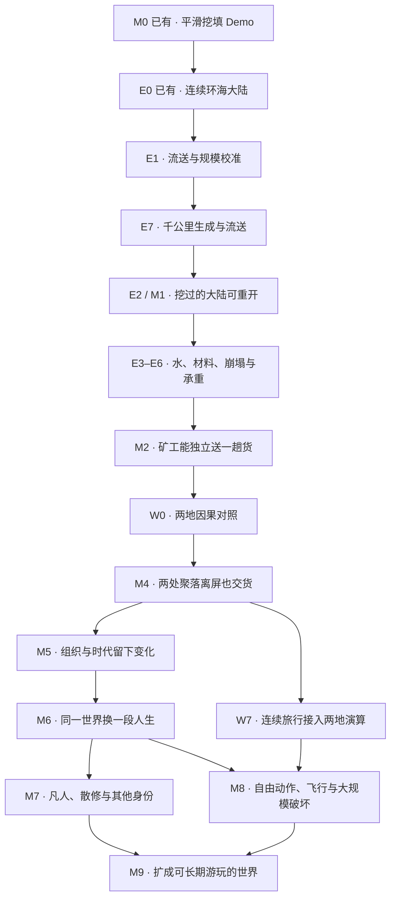

# Reol 2 开发路线图

2026 年 11 月 21 日 · 规划草案。面向一位业余开发者和以 AI 为主的实现方式。每个里程碑有一个可以单独试玩的结果，后续范围随试玩、成本和性能证据调整。

**先把环海大陆引擎做成可连续旅行、下潜、挖建并保留变化的世界。** 岩体、建材和建筑支撑随后分小场景验证，再接入居民、聚落和宏观演算。做内容时，第一条联动仍是地形影响通行，通行改变居民的工作和物资，聚落与组织的演变影响下一次到访。

## 从这里读

| 内容 | 什么时候读 |
| --- | --- |
| [大陆与体素世界引擎](world-engine.md) | E0 已可试玩，E1 已完成首轮流送对照，E2 规划地形存档。进水、材料、岩体和建筑支撑各有独立验收。 |
| [随机大世界方案](large-world.md) | E7 的地貌、洞穴、无缝流送与 `2²⁷ × 2²⁷ × 2¹⁶` 格坐标的验证。 |
| [大陆体素存储与流送选型](voxel-storage.md) | E1–E2 的密度容量、生成范围、同值折叠、稀疏改动、预取和保存方案。 |
| [游戏设计与大胆构想](game-design.md) | 想知道玩家在做什么、世界如何演变，以及这些想法怎么低成本验证。 |
| [世界实现与性能验证](architecture.md) | 要修改地形、存档、通行、NPC、远区演算或性能预算。 |
| [M1–M3 · 地形、居民工作与无缝小地图](foundation.md) | 建立存档对照和引擎接入居民工作的验收，相关大陆流送任务进入 E0–E2。 |
| [M4–M6 · 自治地区、时代变化与新人生](world.md) | 验证宏观与微观互相影响的主线。 |
| [M7–M9 · 做出不同活法、飞行与规模扩张](expansion.md) | 从已经可玩的世界逐项扩张。 |
| [路线图编制记录](review.md) | 核对首轮规划来源与后续模拟的待验证假设。 |

## 起点与优先级

- **已有。** 大陆可跨区旅行、潜水与挖建，改动可在同一会话跨卸载恢复。首轮流送优化、独立 Windows 构建和验证结果记在当前状态页。[当前状态](../README.md) · [大陆实测](../continent-demo.md)
- **近期。** 随机大世界已有可玩构建。下一阶段在同一份全局坐标和生成版本上接入跨会话编辑。海水连通、材料强度、岩体坠落和构件承重继续各用固定场景验证。[大世界实测](../large-world-demo.md) · [世界引擎实施顺序](world-engine.md#8-开发顺序与验收)
- **中期。** 两处聚落和一条路就能验证远区运转。等玩家回到旧地，能在场景、人物、价格和公告里看到有共同成因的变化。世界的随机性和玩家的干预都可以改变结果。
- **长期。** 连续旅行与飞行、可玩过多段人生、门派与国家兴衰、不同身体和身份、自由动作战斗与高魔地形变化。剧情、地理规模、战斗形式和素材数量跟着可玩证据逐项定。

这里的地图、身份组合、样本规模和性能阈值都是规划起点。以开发者已确认的方向为准。愿景或随口举的例子可以通过后续决定调整。[原访谈整理](../design-direction.md) · [游戏简报](../preproduction/brief-reol2-2026-11-21/brief.md)

## 开发顺序

| 阶段 | 交付给玩家的体验 | 进入下一阶段的证据 |
| --- | --- | --- |
| **M0 · 平滑挖填** | 沿坡走到洞口，挖开、通过、填回。 | 已有负坐标、接缝、占用拒绝和返回点相关测试。这个规模保留为对照场。 |
| **E0–E1 / M3 · 大陆与流送** | 跨多处地图、下潜、飞过海湾并回到挖过的原地。 | 多方向同尺度接缝稳定，前方碰撞能及时就绪，卸载后内存和积压能回落。 |
| **E7 · 千公里生成与流送** | 按种子在连续世界旅行，从海岸和山口飞入可下落挖填的巨洞。 | 世界范围、表面密度及速度的各组对照可独立归因，远坐标和近处无缝。 |
| **E2 / M1 · 地形可重开** | 在接缝修改地形，关闭游戏后重新打开，坡面、洞口和再次选格仍正确。 | 有序编辑可往返，坏档和中断写入保留上次完整结果。 |
| **E3–E6 · 水、破坏与承重** | 挖通海下洞口、切离小岩体或破坏建筑地基，能观察新改变的路线。 | 进水、受伤、落地和承重都有独立样本，远处的变化与近处接上。 |
| **M2 · 居民完成一份工作** | 看工人从矿场送货，挖断路面后能改道或报告受阻，修路后继续。 | 资源守恒、重复触发不重复结算，搬运中和受阻时读档都能继续。 |
| **M4 · 两地自行往来** | 在甲地离开一趟商队，之后在乙地看到同一批货、相同的人和合理的到达时间。 | 离屏、回到近处和读档可以任意穿插，货物、角色与行程始终唯一。 |
| **M5 · 组织与历史** | 返乡发现换了主事人、改了服务或税率，也能在世界中找到原因。 | 固定种子与操作可复验，玩家干预和未干预导致可解释差异。 |
| **M6 · 同世界新生** | 这个角色死了，换成世界中已有的另一个人，或推进若干年再开始。 | 前一段人生的地形和世界历史在新人生可查，时间跳跃能被暂停、验证和继续。 |
| **M7 · 不同身份** | 作为经营者、散修或组织执事时，面对同一局势有不同操作、信息和收益。 | 至少两套操作循环各自能玩，第三套复用实际存在的公共规则。 |
| **M8 · 动作与飞行** | 能在地面近战、尝试自由远程与短程飞行，能力改变场景也改变通路。 | 高速移动时地形安全就绪，战斗与挖填叠加实测可运行。 |
| **M9 · 世界扩张** | 地区、文化、生态、事件和身份可组合出不同年代的故事，长期存档可继续。 | 大小地图的基准、多个种子和长存档稳定，资产扩张能由现有流程负担。 |

引擎与 M2 通过后，W0 在小规则对照里验证断路怎样影响运输、库存和收支。M4 可在两处场景内先验证远方接续，W7 再接入连续大陆，测步行、装卸、改地形及 NPC 的叠加开销。M7、M8 都承接能持续演变的世界，实际排期优先做对下一次试玩更有价值的一条。

## 两个可给自己试玩的版本

**第一版 · 山路与矿工（M2 结束）。** 约 3–5 分钟。挖、填、看 NPC 工作、带着编辑与工作状态重新进场。验证之后仍可回到现有的两区块体素对照场。

**第二版 · 归乡与来世（M6 结束）。** 拟做一段 20–40 分钟的自选游历。地图先有两个可到达的据点和一个可改变的路口。能追一次货物流、看到一次有因果的组织变化，以及在保留世界历史的前提下换一段人生。若连续地图仍在验证，两地暂通过显式旅行接续。测试预设可演示一组已知变故，自由游玩的事件与间隔按模拟和随机性发生。某一局没有大灾难也可以完整游玩。

## 怎样推进一个小目标

1. 选前置已通过、最能回答眼下问题的小目标。把玩家能看到的结果、现有代码入口、验收场景和当轮规模写在工作记录里。
2. 能用已有规则实现时优先接上已有入口。把工作拆到一次能录屏、跑测试或测量的交付量。接口先用于自己的切片，第二个实际调用者出现时再提取公共部分。
3. Unity 玩法走真实场景的 Play Mode 或 Windows 构建。纯规则、存档往返与时间推进在小规模测试中验证。每次性能记录带上地图规模、编辑序列、活跃对象、机器、构建参数和原始数值。
4. 提交前复读 `AGENTS.md`。有不确定的技术取舍可以开双顾问，让两路看同一份复现和代码。由当前执行者记录采纳或搁置的理由。GitHub 沿用轻量静态检查与顾问模拟测试，Unity 验证记录在开发机。[开发与验证入口](../development.md)

**下一批从 E2 的跨会话保存开始。** 用已有的唯一所有者页和全球键接入样本覆盖编码和事务。保持大世界与两公里大陆两组对照路线，场景重开后复查近处表面、碰撞和选格。[大世界验证](large-world.md#实施顺序与可交付验证) · [存档对照](voxel-storage.md#存档验收)
