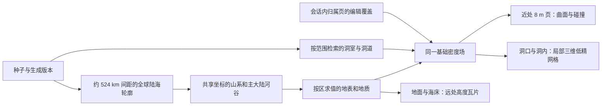

# 随机大世界生成与流送方案

首版可试玩。完整坐标范围为 **`2²⁷ × 2²⁷` 个水平格，垂直 65,536 格**。按 1 米一格计算，边长 134,217.728 公里，海平面上下各 32,768 米。全域使用同一世界种子，按需生成与编辑。已实际走通千公里区域高空穿越、64 公里贴地飞行、巨洞双入口和四远角的挖填回访。[大世界试玩与实测](../large-world-demo.md) · [两公里大陆对照](../continent-demo.md)

第一版用 **低分辨率世界总图、按需地形生成、局部三维地形和稀疏编辑**。区域内部持续走、飞、游，远距离传送可等落点准备完成。世界范围、实际地貌、可见距离和移动速度各自作对照。具体峰高、海沟、洞室尺寸、速度和预算按技术试验调整。

## 世界尺寸要和运行负载分开

| 1,000 × 1,000 公里的数据 | 容量或工作量 |
| --- | ---: |
| 每 8 米一个浮点高度，直接放大当前高度数组 | 58.21 GiB |
| 每 8 米一列，整张图按旧远景两三角形一格铺开 | 156.25 亿列、312.5 亿三角形 |
| 海平面以下 256 米，每 0.5 米一个 4 字节密度样本 | 约 8.21 PB |
| 首轮标高 −1,024 到 +4,096 米，同样铺满密度 | 约 163.86 PB |
| 加高加深剖面 −4,096 到 +12,288 米，同样铺满密度 | 约 524.30 PB |
| 每 4 公里一个区域骨架节点，千公里对照 `251²` 个节点、试算每点 24 字节 | 约 1.44 MiB 有效载荷 |

密集体积对照为 `(水平边长 / 0.5 + 1)² × (垂直跨度 / 0.5 + 1) × 4`。完整坐标域共有 `2⁷⁰` 个逻辑格，每格铺 1 字节就是 **1 ZiB**，连无岩石处一起铺半米密度约 **32 ZiB**。以 8 米步距铺一张浮点高度图也约 **1 PiB**。

| 完整水平范围的骨架对照 | 每点按 24 字节试算的载荷 |
| --- | ---: |
| 4,096 米间距，`32,769²` 个节点 | 24.001 GiB |
| 262,144 米间距，`513²` 个节点 | 6.023 MiB |
| 524,288 米间距，`257²` 个节点 | 1.512 MiB |

首版用间距 524,288 米的全球节点确定陆海轮廓，主山系和主大陆河谷由共享的坐标函数求值。全域河网若需要细化约束，可对照 262,144 米全球节点与 4,096 米按需区域骨架。按后一方案计算，一张 262,144 米宽的活动区域骨架有 `65²` 个节点，约 99 KiB 的节点载荷。现有生成缓存、网格与碰撞随活动范围卸载，编辑覆盖保持到会话结束。

两公里对照场景仍使用固定的高度数组和远景瓦片。大世界分支用 `WorldSurface` 按需供给高度节点，用 `WorldFrame` 转换射线与编辑坐标，`WorldHorizon` 从视野附近根瓦片开始细化。两条路径共用 8 米三轴页、19³ 采样与法线 halo、可见面提取、碰撞双缓冲和运动扫掠。[地形底场](../../Assets/Reol2/World/ContinentField.cs) · [大世界远景](../../Assets/Reol2/World/WorldHorizon.cs) · [玩家入口](../../Assets/Reol2/World/ContinentExplorer.cs)

## Minecraft Java 的尺寸与实现参考

核对 Mojang 发布的 **Java 26.1** 无混淆客户端和服务端。其主世界默认边界完整边长为 **59,999,968 方块**，以原点为中心约为 `X/Z=±29,999,984`。Reol 2 的目标边长约为它的 **2.237 倍**，水平面积约为 **5.004 倍**。Minecraft 默认主世界的垂直建造范围是 `Y=−64` 到 `319`，共 384 层，配置海平面为 Y=63。[Mojang 26.1 发布说明](https://www.minecraft.net/en-us/article/minecraft-java-edition-26-1) · [该版本的官方发行清单](https://piston-meta.mojang.com/v1/packages/224ef4d5ccb0a181b750765f2fdc591e0072bd3a/26.1.json)

| Minecraft Java 26.1 的做法 | Reol 2 如何应用 |
| --- | --- |
| `ChunkPyramid` 按结构、群系、噪声、表层、雕刻、装饰和光照等阶段生成所需区块。主世界的噪声生成器会缓存二维项，并对部分密度函数用粗采样格插值。 | 低频地表项按 XZ 缓存，大片空域和实岩先作范围判断。洞口和近处零面继续精确取样，避免粗采样吞掉开口。 |
| 区块横向 16×16，垂直切成 16³ 区段。方块状态用局部调色板和位压缩存索引，单一状态可用零位索引。磁盘 `.mca` 区域文件以 32×32 个区块为索引范围。新生成的完整区块会标记待保存，并可写入整个区块状态。 | 继续用自己的三轴页与确定性底场。离散材料适用同值折叠。精确密度页主要保存编辑覆盖，昂贵但可重建的数据按容量缓存。 |
| 客户端按可见区段、遮挡和脏标记调度网格重建。模拟距离与视距有独立设置，远方可见地形不需要一起高频地更新实体和流体。 | 精确碰撞和高频模拟随活动范围，远景按视觉需要加载粗瓦片及局部三维洞壁。沿用独立的构网、发布和卸载预算。 |

官方 JAR 的校验、配置与符号核对记录在本机 `.local/research/large-world-2026-11-21/minecraft-java-26.1/` 的 `inspection.log` 与 `detail.log`。这里只借鉴分阶段生成、局部压缩和活动范围管理的原理。1.18 也记录了旧地形升级时对地表与群系的过渡，洞穴衔接需要另行处理。[Mojang 1.18 区块格式、模拟距离与旧档过渡](https://www.minecraft.net/en-us/article/caves---cliffs--part-ii-out-today-java)

## 随机总图和地貌

### 世界坐标与生成契约

- **坐标域。** 海平面为 `Y=0`，全图共用这一基准。格坐标 `X/Z=[−67,108,864, 67,108,864)`，`Y=[−32,768, 32,768)`。最后一层格子从 `Y=32,767` 到 `32,768`。地表标高独立由地貌生成。移动限制用角色包络与世界边界面检测，逻辑边界为有限方形。千公里测试窗口使用同一个世界定义。
- **整数键和边界采样。** 每轴 1 米编辑格、0.5 米样本与 8 米页的坐标均适用 `int`。格和可构网的页用半开范围，密度样本包含正边界面。负坐标向下取整，样本 `−1` 属于第 `−1` 页内编号 15。按常规所有权分配时，正边界样本的页键只承载采样和相应编辑。域外的法线 halo 只读最近的边界样本，视图和移动查询都按有效范围裁剪。8 米几何页的三轴地址分别占 `24 + 13 + 24` 位，首版用分轴整数作键，采样页也可表示正边界。距离平方和跨度乘积在乘前提升为 `long`，局部调度可直接使用小范围差值。源代码的 `Vector3Int.sqrMagnitude` 用 `int` 乘法，跨世界计算要单独处理。全域格数用幂或任意精度做容量验算。[Unity 的 `Vector3Int` 实现](https://github.com/Unity-Technologies/UnityCsReference/blob/master/Runtime/Export/Math/Vector3Int.cs) · [编辑归属与读写](voxel-storage.md#具体怎么存一页)
- **三轴浮动原点。** 连续世界位置使用 `double`，先扣除按 512 米对齐的三轴整数锚点，再转为场景 `Vector3`。若直接把 `67,108,863` 转成 `float`，它会舍入到边界 `67,108,864`。先试本地偏移约 2 公里时重定位，在移动与物理查询前更新活跃地形、角色、相机及相关历史位置，按需同步 PhysX。网格顶点使用页内位置，构网任务用全球键和编辑版本。旧原点下生成的页可按新锚点挂载，依赖旧局部坐标的查询需重算。射线命中加回同一锚点后再选格。水面使用 `0 − 锚点.Y`，着色噪声和水波用全球坐标或预先归约的相位，以免换原点时平移。单独测重定位帧、物理同步与接触稳定性。[Cesium for Unity 的浮动原点与限制](https://cesium.com/learn/unity/unity-placing-objects/) · [Unity 6.3 Physics.SyncTransforms](https://docs.unity3d.com/6000.3/Documentation/ScriptReference/Physics.SyncTransforms.html)
- **确定性。** 世界定义包含 64 位种子、生成版本、边界、密度尺度与配方参数。大陆、地貌、洞穴与植被分别使用固定哈希命名域。噪声的晶格键是全局整数，插值只用晶格内相对坐标。当前由全球采样坐标构造 `Vector3` 再计算底场的入口要迁移。生成区域的先后、线程数、卸载与否和本地原点都可以改变，样本及特征 ID 仍可复现。跨机器或 Burst 路径以哈希、采样精度和零面符号对照验证。[底场采样入口](../../Assets/Reol2/World/ContinentField.cs)
- **可定位的开局。** 在总图内选符合条件的陆地候选，再查局部坡度、净空和碰撞。搜索有固定尝试数和种子派生的备选区域。验收种子额外记录可复游的海岸、山口、峡谷、洞口坐标。普通随机种子按同一生成规则提供地点，玩家可用种子重开已有地貌。

### 从四公里格跨到下一段山脉

约 4 公里是区域地理骨架相邻节点的距离。几个节点可共同描述一条山脉，一个节点可记录以千米计的海拔。局部求值用连续噪声及山脊曲线补出小于骨架间距的地貌。一条 **160 公里**的山脉可跨约 **39 段 4,096 米的间隔**，让其中心线、支脉、山口和抬升范围沿世界坐标延伸。约 16 公里的特征目录首轮试用 16,384 米网格快速查找这种山脉与相邻洞道，目录只持有相交段的引用。

1. **跨区读取同一形状。** 全世界使用一个主种子。区域随机量从主种子、坐标和用途导出。山脉和洞道的相交范围可跨区，河流由共享出口和同一段中心线连通。在区域边沿渐变气候、岩层和起伏幅度，两侧求值看同一组描述。不同主种子通常代表不同存档。若要合并两个现有世界，需要另建过渡带并重接河流与洞穴。
2. **跨页读取同一采样。** 接缝两边使用相同全球采样键和邻页 halo。分别按 A 先加载、B 先加载和跨页挖填回访检查接缝。近远层级另外验证几何补缝与代理裁切。
3. **区域水系共享约束。** 全球层先给主要流域、沿岸出口与跨区河道建拓扑。交界河段按同一条主河 ID 和规范边键取得位置、流向、河床标高及必要的入流条件。局部填洼把主河与边界出口作为已定边界，支流在可控范围内合流。各区生成只取附近共享的干流描述和汇水摘要。固定反例在跨区主河旁放一个更低的深洼地，从上下游分别开始查询，检查入出口标高及位置一致、主河连续下坡并保持原出口，记录为生成单区而请求的邻区数。

### 标高、盆地和地下深度

| 尺度 | 首轮设计或验证参数 |
| --- | --- |
| 海平面和山脉 | 第一批雪峰取 4–6 公里高，极高峰试 8–9 公里。山脊长度、峰高和可走山口分别控制。高空压力路线飞到 `Y≈+32,760`，另设一处靠近上边界的落脚面，测地面可见范围、近场碰撞和跨锚点选格。 |
| 盆地 | 一个高原盆地可用底面 `Y=+1,500`、周缘 `Y=+3,000`，相对落差 1.5 公里。另一对照为底面 `Y=−150`、向海溢流口高于海面。低地由海域连通性与湖盆水位决定是否有水。 |
| 洞穴 | **200–300 米是主洞室的净高。** 首条多层洞系用 `Y=+300` 的入口和 `Y=−1,700` 的洞底验证 2 公里落差。再放置靠近 `Y=−32,760` 的独立试验洞，验证就地挖填、回访与下边界。 |
| 海沟 | 用一条约 11 公里深的海沟和普通海域做下潜对照，验证高空看到海面、穿越水线、到海床及继续下挖的接续。海水状态读取水体与局部连通信息。 |

用 `Y=[−1,024, 4,096)`、`[−4,096, 12,288)` 和目标全高做三档对照。先只移动上下边界，再增加可见断面、多层洞壁或深海路径。额外的岩层和高空通过底场表达，构网和碰撞耗时随活跃表面变化。真实世界的高度和深度可参考珠峰约 8.8 公里、维廖夫金纳洞入口到底约 2.2 公里、挑战者深渊约 11 公里。[NASA 珠峰测绘资料](https://science.nasa.gov/earth/earth-observatory/close-up-of-mount-everest-149632/) · [洞穴深度纪录](https://www.guinnessworldrecords.com/world-records/deepest-cave) · [NOAA 海洋深度](https://oceanexplorer.noaa.gov/ocean-fact/ocean-depth/)

### 从大陆到河谷

1. **大陆、海与地质。** 低频连续场和少量按种子生成的大陆核心决定陆海比例、大陆架、岛链与抬升带。外缘的海洋余量用世界坐标定义。跨区山脉沿同一地质带延伸。总图保存高度、湿热、地质和导流所需的紧凑节点信息。首次后台生成并报告阶段耗时。总图可作为种子和版本关联的可重建缓存。
2. **流域先于局部地表。** 千公里对照可从连到海洋的节点开始，在参考 4 公里图上做 Priority-Flood 洼地处理，选确定性下游。全域按全球和区域两层处理。按填洼高程及访问次序确保粗层下游图无环，在逆序遍历中汇总粗径流。封闭湖指定蓄水面与溢流口。区域河段细化时约束河底、两岸和汇合点，减弱河道附近的高频地貌，防止横切岩脊把河堵住或挖出整齐的直槽。窄岛、小湖和支谷用局部地貌补足。用窄分水岭与峡谷急弯对照 4 公里和更细网格的生成时间、河段偏差与地貌一致性。[Priority-Flood 原始论文与流向用法](https://doi.org/10.1016/j.cageo.2013.04.024)
3. **区域塑形。** 每个点混合此处连续的平缓度、抬升、干湿和地质权重。先做缓坡与台地、山脊与峡谷、岸线与海床三组，再接喀斯特地貌。可分别调各层起伏幅度和频率。坡面、气候和地貌分开决定颜色、植被和材料，邻区共用同一混合函数。越远用越粗的地貌信息，省去无法分辨的高频细节。
4. **区域特征有归属。** 河段、洞室、洞道和显著地貌使用稳定 ID 与世界包围范围，区边上的查询会找到同一组影响源。首个按需查询目录按实际影响范围反查邻区。对于大河或其他跨度更大的已知特征，用粗图上的全局河段索引。细节生成失败或缺缓存时，新区域保持待确认。

| 首批地貌 | 玩家看到的差别 | 主要生成路径与检查 |
| --- | --- | --- |
| 环海大陆、岛链、海岬、沙滩、陡岸、大陆架和海槽 | 海上能辨认大岛与航向。从沙滩可走进水中，沿海床能潜到陆架断面。 | 低频陆海轮廓和分段海床剖面。检查海岸两侧水域归属、岛屿的海拔连续性和下潜碰撞。 |
| 丘陵平原、高原、盆地、林谷与湖泊 | 有长距离缓坡和能远眺的台地。湖盆边缘与分水岭能辨认。 | 区域混合曲线、地表低频层和湖泊水位。检查普遍可走的坡面及湿地低洼。 |
| 连续山脉、鞍部、雪峰、峡谷和阶地 | 飞越分水岭能看到背坡，峡谷下有河，上方有绕行的山口。 | 山脊函数、侵蚀近似、河道剖面与固定标高带。峡谷河底下坡，峭坡保留走路可绕行的路段。 |
| 天坑、溶洞、地下峡谷、岩桥和石柱 | 能从洞口望进纵深，飞到不同标高的洞底、桥面和洞顶。 | 可索引的局部三维体积。首轮打通一处贯通洞系，再扩展湿溶洞、熔岩洞、冰洞等候选。 |

参考《Minecraft》把大洞腔、长洞道和窄支道用不同形状生成，参考《Vintage Story》用分档噪声和层高规则区分大尺度地貌。Reol 2 的地表与洞线按自己的种子配方生成。远方第一次看见湖和海岸时可以用粗水面。近处水面和潜水判定与同一水体 ID、海床或湖底对应。洞内涌水继续沿海床连通方案推进。[Minecraft 1.18 官方地貌与洞穴说明](https://www.minecraft.net/en-us/article/caves---cliffs--part-ii-out-today-java) · [Vintage Story 地貌配置](https://wiki.vintagestory.at/Modding:WorldGen_Configuration) · [分层河网与河谷雕刻论文](https://perso.liris.cnrs.fr/egalin/Articles/2013-river-networks.pdf) · [当前水体方案](world-engine.md#4-海水洞穴和可挖海床)

## 巨洞怎么生成和裁剪

**首个验收目标。** 生成一个约 **1 公里长、数百米宽、200–300 米高**的主洞室，接到数公里的地下通路。至少两个玩得到的入口，涵盖贴地走入和空中穿入。在洞内验证接缝挖填、屋顶和落地碰撞、多层岩架及从另一出口回到地面。种子可以改变洞室朝向、轮廓、走廊和支洞布局。

1. **先生成可通行的骨架。** 从地质适合的区域选择锚点。主洞用相交的椭球或圆润体积，走廊用离散为有界胶囊段的曲线。主洞与洞道有经检验的交叠宽度。比较每段洞顶上界和保守的地表下界，给带扰动的洞顶保留岩层，入口是特意允许穿出的部件。候选位置不足时按固定次序换锚点或降低洞顶。验收模板布置一处桥和一处岔道，保留能走或飞通过的净空。每条跨区连接由一对端点的有序 ID 唯一生成。
2. **只算查询范围遇到的特征。** 以洞室、洞道段或局部装饰为索引单位，同一座巨洞可拆成有界的几何部件。首次请求该处 64 米盒时，按世界坐标反查可能伸进来的区域，用保守影响范围取得候选。结果按 64 米盒缓存，盒内 8 米页共享列表。范围包含洞壁扰动、混合宽度和网格 halo，贴 64 米边界的页也得查盒外的 halo。优先用小型 AABB 列表。遇到过多候选，再比较对局部索引细分与短段分桶。进入一座洞只请求附近壁面和落点，洞室只存形状描述。
3. **先判一页有没有表面。** 地表 `D₀=y−H`，负值为实。洞内用洞体密度的反号挖出空间，叠加到同一底场。对每个洞形先计算带有限影响范围的连续贡献，再以 `max` 合并挖空。在几何洞壁之外，用平滑权重将密度渐归到原始地层，到了影响界限贡献正好归零。洞壁细节可用有界世界位移，先扩展查询盒再做区间计算。以 8 米页判空实为基线，64 米上层盒能覆盖多次请求时试批量跳过，对比少取的样本和维护盒缓存的实际成本。19³ 浮点采样只给仍需构网的页。必要邻页重新取精确 halo，空实分类本身只记录占用。保守范围有疑问或发现相关编辑时按完整浮点采样检查。
4. **洞顶、洞底、上下层分别处理。** 屋顶下的空域用解析分类，楼层和隧道的可见面在活动范围流送。大洞边缘的岩桥、石柱和断崖可局部做低精三维渲染。只给玩家即将碰到的壁面和落点挂高精碰撞。近处洞墙的编辑依已有的共享样本和来源语义，向受影响的空间位置失效。同一洞的其它分支无需构网。
5. **制作可证伪的探针。** 关掉裁剪做同一批 8 米页与 64 米盒的对照，检查已跳过的页连 halo 都同号，有表面的页逐样本和逐接缝比对。对椭球切点、扰动极值、可穿行窄口、负坐标页角和巨洞跨 16 公里区单独用例。任意遍历顺序拿到同样的洞壁与端点。

独立算量用了 **1,024 × 256 × 720 米**椭球、均匀实岩、每轴至多 6 米的洞壁位移和有界混合带。向外按 64 米取整后的包络共含 774,144 个 8 米页，约 97,600 个仍需检查表面。逐页铺 `19³` 的理论取样量由约 53.1 亿降到约 6.69 亿。这里故意统计整个洞的包络，运行时只求活动范围交集。多段交叠、真实编辑、网格和烘焙仍要在 Unity 压测。同一试算用三种简化地貌测试了 251² 节点的填洼和汇流，独立 Python 中位约 87–90 ms，验证了汇流守恒。两组算量记录保存在本机 `.local/research/large-world-2026-11-21/check_plan_envelopes.log`。[Voxel Tools 区间分析源码](https://github.com/Zylann/godot_voxel/blob/4b29b07817230bfc28a542b17e7d39a7ef5fcb91/generators/graph/voxel_generator_graph.cpp#L770-L833) · [Luanti Mapgen V7 洞穴组合](https://github.com/luanti-org/luanti/blob/master/src/mapgen/mapgen_v7.cpp#L299-L351)

## 无缝看到、接近和进入

**沿三轴请求活跃页。** 原型的近场基础窗口为 `9 × 5 × 9`，共 405 个候选页，另有前视走廊。在完整纵深中给同样 81 列枚举所有高度会变成 663,552 页。高空、长水柱和深岩先用同一范围判定，只在活动包络与真实表面相交的地方抽壳。页状态区分待确认、已证实为空、已证实为实和表面碰撞就绪。全实页无需内部 Mesh，进入和落点仍要通过占用与移动包络校验。范围有疑问或编辑快照不齐时走精确路径或等待。只在 8 米页的非表面判定占用显著时用 64 米父盒合并证明，并复核洞壁、细小凹凸和 halo。

| 范围 | 表现与碰撞 | 内存和更新 |
| --- | --- | --- |
| 脚下、可编辑范围、即将通过的走廊 | 8 米高精页。按角色扫掠和当前表面修订提供碰撞、选格和相机避障。 | 空实页只记分类。每次只处理新增和失效的页。邻页有未读覆盖时保留最后有效状态。 |
| 地表与海床的中远景 | 33×33 顶点的常规高度瓦片，初试 2 米采样、64 米宽，按 2 倍提升块宽与间距。按屏幕误差、视锥及速度调换档，水平和垂直能见距离分别控制。 | 只建当前范围及下一档需要的瓦片。粗父片继续覆盖，子片完整准备后替换。相邻层级相差一级，固定嵌套格点配过渡条或变形。持久缓存按字节回收。 |
| 高空海面与漫长水柱 | 用水体的标高与岸线覆盖绘制局部海面，从同一场景换算得到入水位置。海床按高度瓦片或局部三维地形呈现。 | 海水按水体与有界连通区域表达。下潜用接近海床、岩壁和洞口的走廊带起碰撞。海面、阴影和水下效果有各自的视距与成本预算。 |
| 外部可见的洞口、石拱与大型编辑 | 用与近场同源的体积采样生成局部低精三维网格，洞口所在范围由三维覆盖接管。 | 先验证一对 2:1 边界的过渡单元，然后推广到洞口的带状区域。高度瓦片和三维网格只在证实为单值的外边界相接。需要时从体积网格抽出边线约束高度网格。 |
| 巨洞内部 | 围绕相机流送低精洞壁，按玩家包络流送近场碰撞。远处洞顶和桥架可提前看见。 | 按三轴邻域、视角和洞口粗包围盒请求。高精页和低精页共享坐标和修订，逐对切换。来不及生成低精时保留先前可信代理。 |

默认选**按需的高度瓦片树**做地表远景，处理随机远传、粗层占位和大挖坑的局部失效。高空覆盖如果取 512 公里见方，整面铺 8 米网格将产生约 **81.92 亿个三角形**。高空按屏幕投影误差跳过细层，用可见瓦片数、三角形、在途字节和发布量限制细分，预算不足时优先保住粗父片。若连飞的瓦片更新、绘制或上传成为瓶颈，再用 Geometry Clipmaps 的定长同心环与差分更新做对照，包含跨多级网格边界同时更新的成本。高空俯视、低空贴地和冷区远传共用同一地貌样本。[Geometry Clipmaps](https://developer.nvidia.com/gpugems/gpugems2/part-i-geometric-complexity/chapter-2-terrain-rendering-using-gpu-based-geometry)

**用可交接的表面片区更新画面。** 现有 `FlushColumns` 会逐层检查整个 `SurfaceBand`，只在全齐时显示近处网格。若陡崖的标高带跨逾五层，而同一列当前只覆盖五层，就可能已有碰撞却看不到近处崖面。新方案按有界表面片区发布，覆盖完整且与周围代理的边线能对接时才替换该片粗几何。多值地形用局部三维代理承接，接缝移到可连续表示的外边界。洞口要以同一修订发布三维形状和高度瓦片裁切，保住正在接近时的真实开口。近场沿用 Marching Cubes，三维 LOD 补缝先做一个 2:1 对照。[现有 `FlushColumns`](../../Assets/Reol2/World/ContinentTerrain.cs) · [Transvoxel 过渡单元](https://transvoxel.org/) · [Voxel Tools 平滑体素与差分流送](https://voxel-tools.readthedocs.io/en/latest/smooth_terrain/)

用一处高 60 米且洞口跨页的崖面做慢加载对照。先保留当前完整外观，注入一个邻片迟到 500 毫秒，再一次提交齐套片区和裁切。逐帧看洞口边缘与背光轮廓，确认接管期间周围表面一直有覆盖，洞口在进入可交互范围前显示正确，射线只命中当前修订。

用移动意图与预计到达时间预取三轴走廊。将粗画面、已分类的页和真正挂上碰撞的页分别记就绪。显示、碰撞、清理各有当帧额度，保留脚下与路前方的容量。前视距离随 `速度 × 整段就绪 P99 + 制动距离 + 边界余量` 调整。实际连续就绪距离约束下一步速度，保留现有扫掠作硬边界。掉头时撤销未开工的旧请求，保留最近走过的窄滞后环。远传单独准备目标地的包络。持续积压时先减少远景细化并修正热点。以 68 米/秒沿轴移动，假设 9 列宽、每列一层，就有约 76.5 个新表面页/秒，四层约 306。现有 3 页/帧在 60 Hz 下的理论上限是 180 页/秒，实际还受构建时间影响。下一轮量出关键碰撞的真实横截面，同屏看见的其余洞层走低精渲染。

给俯冲转向海壁的路线注入一档延迟。算例取 80 米/秒、离海壁 24 米，约 300 毫秒后到壁。若冷区排队 150 毫秒，再按 60 Hz 每帧发布 2 页，24 页共需约 350 毫秒。即使每帧控制住发布量，路径仍会比角色晚。验收同时记录队首阻塞、实际安全覆盖距离、限速和恢复时间，并验证全实页与待读页都无法被远传选作落点。

**持有内存。** 为已分类页、区域配方与查询索引、近场双缓冲、远景瓦片和在途结果分别记字节，队列高水位给远景细化施加背压。离场后按帧卸载，转头时保住刚准备好的附近碰撞。采样或抽壳迁往后台时，给工作线程独占暂存缓冲和输入快照。结果附世界会话代数、页请求代数及实际读取的编辑修订，包含过渡面的邻页。已开始的过期作业结束后释放，正确结果按当前本地原点挂载。场景视图和碰撞仍由主线程挂载。若测到抽壳或取样的尾部拖累先试独立缓冲与后台任务，若卡在烘焙则先对照后台烘焙独立网格及烹制设置复用。若开销来自主线程挂载或销毁，优先减少每帧碰撞切换、退休网格与提交件数。[Unity 6.3 BakeMesh](https://docs.unity3d.com/6000.3/Documentation/ScriptReference/Physics.BakeMesh.html)

**编辑持久化。** 地貌键、洞形键和样本键在重定位后保持不变。已有的编辑保存计划继续负责精确浮点覆盖、放置来源、半开归属与跨页事务。局部编辑使读取这些样本的近处页、3D 过渡代理与对应的远景瓦片失效。原始低频地理和流域来自种子，地表大改后的远景补丁由实测选择尺度。完全未改的岩层无需存文件。E7 的规模切片先验证会话内返回，E2 加进程重开与慢盘压力。[按页存储与故障验收](voxel-storage.md)

## 压力测试矩阵

测试用同一构建、硬件和公开种子，分开预热、冷进、连续走跑、急转、高飞与长期回访。沿用 1600×900 URP Windows Player 基准，并采独立的 GPU 帧时间。尽量使用真正玩家控制和碰撞。脚本只负责复现路线和故障。每组记 P95/P99、峰值、超预算样本以及恢复时间。

| 对照轴 | 只改变的变量 | 验收重点 |
| --- | --- | --- |
| 世界尺寸与坐标 | 同一局部剖面放在 2.048、32、256、1,000 公里及完整水平范围。固定近场、镜头可见距离与 LOD 设置。 | 同一路线的近场候选、取样、三角形和烘焙数量应一致。将总图、必要区域索引和冷启动单独计时，确认它们与热流送各自的增长趋势。 |
| 完整边界与重定位 | 将可走坡面、洞室及地标分别移到 `X/Z≈±67,104,768` 的四个远角和 `Y≈±32,760`，另测最后一页、边界面、负坐标邻接及高空/地下的 Y 轴重定位。 | 验证碰撞、编辑选格、法线与回访。以最后一格、正边界样本和最外 halo 为一组，核对独占归属与裁剪。相同全球点在重定位前后应命中同格。真实种子另测穿越区域边界。 |
| 高空视觉与水柱 | 先只用 `Y≈+32,760` 的空中轨迹测俯视、低角看地平线和俯冲，保持近场碰撞窗口固定。随后下潜至普通海床与深海沟各一次。 | 记录可见瓦片、三角形、待上传字节与独立 GPU 帧时。场景由远景逐步交给局部表面，近场工作由经过的路线和真实表面决定。海面和水下状态在重定位帧一致。 |
| 可见表面密度 | 同一水平轨迹、步长、窗宽、分辨率和预算下，放 1、2、4 层可见岩层。按实际生成页数和三角形复核倍率。 | 比较每百个表面页的采样、抽壳、烘焙和挂载耗时。扩大普通队列但保持实际表面数作单独对照。检查每次有效覆盖，发现超线性增长先定位重复扫描、密度分支或回收。 |
| 洞穴深度和远近交接 | 先只改变基岩下限，再加入竖井、长廊和千米洞室。过同一处陡壁、天坑及洞中架桥。 | 空白纵深不会平白增加活动几何。从地表、入口、洞内分别取固定机位与 GPU 读回。相邻 LOD 在透出天光的洞缘无裂缝、假堵口或闪烁，近处碰撞归属保持一致。 |
| 移动速度与延迟 | 正常档用当前 68 米/秒、60 Hz。另跑低频 50 ms 步进、170/340 米/秒、90° 与 180° 急转、暂停发布和突然恢复。逐项改变。 | 普通档的已验收路线连续，路径就绪年龄稳定。过量输入会在未准备区域前安全减速，服务恢复后继续。画面完成时间和碰撞完成时间分别记录。 |
| 缓存、移动原点和长跑 | 先跑若干次带编辑的窄区往返，再连续横跨千公里窗口，最后远传并回访。正常路线之外，强制一批作业晚到及一轮渲染、碰撞同帧退休。 | 停下后记录字节高水位与回落、每公里重建与每秒有效完成量。检查碰撞同步、迟到结果、重新选格和海面与着色相位。68 米/秒跑满千公里约 4.1 小时。连续脚本可加速模拟时钟，记录真实步长和速度，实时帧表现用 Windows Player 测。 |
| 多种子正确性 | 自动生成一组固定种子，调换区域查询顺序，重点抽查河网出海、洞口可到达、雨影与雪线。 | 总图与特征 ID 可复现。主干河连续，局部细化不阻塞出海，洞口两侧可达。记录失败种子及坐标作为回归。 |

先把同机同配方的流送 P99 与当前折返约 **1.51 ms** 做对比。为首轮渲染压力测试取 60 Hz（16.67 ms 总帧）作为参考，计入缓冲上传和帧末销毁。平滑区普通档用零流送拦停做回归，多层和超速用可恢复时间及实际走廊供需定位。需记录开始请求到整个走廊就绪的真实尾部时延、有表面和无表面完成量、生成后又撤销的结果、重复构网、三角形、Draw Call、碰撞挂载数、按类驻留内存、CPU/GPU 以及冷启动。指标长尾出现时用分项标记和实际访问次数解释，随后单改一项再测。

**固定反例。** 让半径 6 米的斜洞口壁经过 `(491520,128,−16384)`，该点同时落在 8 米页角、64 米分类边界及 16,384 米目录边界。给洞壁加有界扰动。对周围 27 个页强制跑完整 19³ 样本，与裁剪结果核对，存在异号的输入页被判成全实或全空的次数为零。先后在相邻两页挖填，再让一份旧快照晚到，核对共享样本密度与修订。用真值网格确定洞口中心能通的视线，逐条对照低精代理的三角形遮挡，并从 2:1 边界内外截图。把同一几何放到 4 层路径负载中再测，区分几何正确性与构建吞吐。

**独立坐标探针。** 本机 Python 用二进制单精度验证了远角直接转换丢一米格，局部转换在 12,324 次半米坐标往返中精确。检查八个三轴端角的格、边界面和 halo 所属页。平面夹具移动到四远角和上下标高时，405 个候选页的分类完全相同。在高空和深岩各验证了 405 页全空及全实。代码与输出存于本机 `.local/research/world-domain-2026-11-21/`。这些结果覆盖坐标与算量，Unity 的碰撞和帧时由上述同机用例验证。

## 实施顺序与可交付验证

| 阶段 | 首版实现和证据 |
| --- | --- |
| **E7.1 · 坐标和活页** | `WorldFrame` 与整数页归属已接入同一角色、碰撞和选格入口。Play Mode 覆盖四远角最后一格、三轴重定位和共享采样。 |
| **E7.2 · 带种子的不同地表** | `WorldAtlas` 保存 257² 个陆海节点，`WorldSurface` 按种子生成海岸与大陆架、丘陵、连续雪山、区域河谷和封闭湖盆。主河用同一条解析中心线和单调水位跨区。全球分层流域与支流网仍是地貌扩展项。 |
| **E7.3 · 贯通巨洞** | 主洞室和两条连续通道采用有界图元，空实判定保留 halo。Windows Player 从两端贯穿约 2.48 公里，另有靠近下边界的洞底挖填与回访。 |
| **E7.4 · 从远处看见地形** | 四叉树父片等四个子片齐套再切换。就绪的洞穴页接管附近地表，洞内粗网格补足精细网格边沿。开放地表瓦片之间使用裙边。精粗网格仍有轮廓差异，大尺寸编辑的远景代理另行验证。[同机位渲染回归](../large-world-demo.md#地表和洞穴接缝回归) |
| **E7.5 · 路径调度与压力档** | 保留关键碰撞走廊和主线程分帧发布。记录每路线状态、尾部帧时、页数、待办、动线与密度样本。保守洞室剪枝、按图元扫掠及本地编辑密度缓存已用 Windows 复测。 |
| **E7.6 · 千公里实证** | 同一世界的高空路线横跨约 1,000 × 1,000 公里，贴地路线连续流送 64 公里。分别记录真正经过的坐标、加载拦停、页面完成量及缓存内存。 |
| **E7.7 · 完整坐标域和高空深地** | Windows Player 在四远角读取并编辑真实地貌。在 `Y=+32760` 飞行，从海面下潜至约 `Y=−11172`，在 `Y≈−32756` 的深洞挖填并卸载回访。跨进程保存随 E2 接入。 |

实测数据、玩家入口和复现命令见[大世界试玩与实测](../large-world-demo.md)。扩大洞网密度、车辆速度或视距时沿用压力矩阵，先让对照动线与实际表面量可重复，再调线程和工作预算。

## 成熟项目的可复用做法

| 一手资料 | 在 Reol 2 用在哪里 |
| --- | --- |
| [Vintage Story 世界设置](https://wiki.vintagestory.at/World_Configuration#World_generation) | 默认横纵各 1,024,000 方块，是相近量级的方块沙盒例子。它把世界范围、气候、陆海比例与地貌设置分开。本项目以本地基准定义平滑网格和洞穴负载。 |
| [Daggerfall Unity 流送源码](https://github.com/Interkarma/daggerfall-unity/blob/master/Assets/Scripts/Terrain/StreamingWorld.cs) | 浮动原点补偿与世界位置分开，按邻近地图像素放置并循环复用地形块。可借鉴 Unity 层的窗口与本地放置组织。 |
| [Voxel Tools 平滑地形](https://voxel-tools.readthedocs.io/en/latest/smooth_terrain/) · [性能文档](https://voxel-tools.readthedocs.io/en/latest/performance/) | 借用同心盒的差分更新、保守区间求值和地表采样外提。三维分辨率过渡在这类项目中已有成套实现，可逐项验证。 |
| [Luanti Mapgen V7 源码](https://github.com/luanti-org/luanti/blob/master/src/mapgen/mapgen_v7.cpp#L299-L351) · [Minecraft 1.18 官方说明](https://www.minecraft.net/en-us/article/caves---cliffs--part-ii-out-today-java) | 结合分块种子、开阔洞腔、长隧道和窄支道。本项目先保证洞室、连接段和入口相通，再用噪声丰富洞壁。 |
| [Hello Games 的连续世界生成分享](https://www.gdcvault.com/play/1024265/Continuous-World-Generation-in-Noby) · [《无人深空》新版地形说明](https://www.nomanssky.com/worlds-part-I-update/) | 地貌求值、曲面提取、着色与内容填充是可单独量的阶段。Hello Games 的新版仍能通过改抽壳减少顶点和内存，说明同一地图需要看每阶段实际产生的量。 |
| [分层流域与地形建模论文](https://perso.liris.cnrs.fr/egalin/Articles/2013-river-networks.pdf) · [Geometry Clipmaps](https://developer.nvidia.com/gpugems/gpugems2/part-i-geometric-complexity/chapter-2-terrain-rendering-using-gpu-based-geometry) | 跨区河谷以稀疏河网约束，按需雕刻局部剖面。地面远景借用多分辨率高度数据和移动时差分更新。 |

## 顾问评审与取舍

千公里场景和巨洞方案先用 Gemini Web 的 Neon High、Neon Task 评审底场、远景、水系和洞口。确定 `2²⁷` 水平范围及 65,536 米垂直跨度后，同一双路又做了两轮，收到四份完整回答。首轮审查源码与规模，第二轮用本机探针和四个固定反例复审。两批原始咨询分别位于本机 `.local/research/large-world-2026-11-21/` 和 `.local/research/world-domain-2026-11-21/`。关键源码与开发者资料另行核对，阈值由同机验证决定。

- 全域陆海与主河用较粗的全球拓扑，区域通过规范边键细化。4 公里密集骨架保留在千公里小图对照中，用来检查粗层是否遗漏分水岭与河谷急弯。[板块内河网预印本](https://arxiv.org/abs/2610.00301)
- 首轮两路分别推荐高度瓦片树与 Clipmap。优先采用瓦片树以支持随机远传、局部修改和高空裁剪，Clipmap 对照聚焦连续飞行的远景更新。巨洞先用有界描述与局部页判定跳过实岩和洞心。64 米父盒、八叉树与并行按各自实测热点引入。
- 陡崖先保留完整代理，等待可以安全替换的片区。重定位时保留按页局部坐标生成且依赖仍有效的烘焙结果，按当前锚点挂载。边界挖填使相关闭合样本页和读取它的几何页一起更新，晚到的旧覆盖或旧碰撞按修订拒收。先跑原型中的异步顺序对照，再由 E2 加入实际读盘延迟。
- 体积合并先以确定的 `max/min` 做。常见的多项式 smooth-min 重复合并可能受组合顺序影响。较粗网格张开的洞口也可能错削岩壳，因此用局部加密和一致的裁切保护开口。高度裙边负责单值地表的视觉裂缝。近处连续碰撞保留扫掠检查，有限个密度探针会在高速下漏过薄岩壁。

编码时用 Gemini Web 的 Neon High 与 Neon Task 做了四轮复审，分别核对坐标接入、远近接管、Player 热点和冷缓存编辑。采用了相机附近优先细化、保留空页覆盖的三轴裁切、以同一底场合并图元及按所有者页散射编辑。洞形剔除保留逐点距离公式，以完整采样盒的保守范围证明哪些图元被更强的洞形覆盖，再核对八页交界处的逐点密度、首次编辑 CPU 耗时及总帧时。额外的高空放置验证远处单次编辑不会触发全域取样。评审和实测原始材料在本机 `.local/research/e7-implementation-2026-11-21/`。[大世界实测](../large-world-demo.md)
