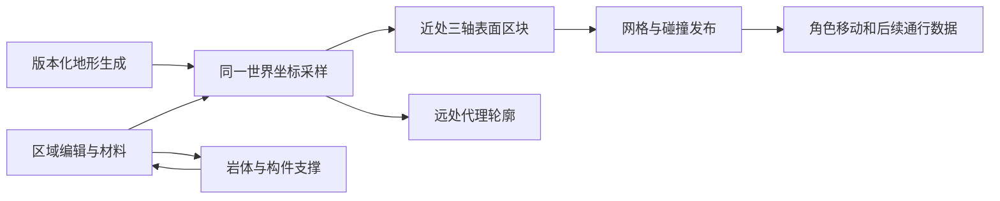

# Reol 2 大陆与体素世界引擎

2026 年 11 月 22 日。随机大世界已可试玩，每个水平轴 `2²⁷` 格，海平面上下各 32,768 格。两公里大陆提供同机对照。本页中的小图尺寸和预算描述大陆基准。地形持久化、材料、岩体重力与建筑支撑沿各自用例验证。[随机大世界实测](../large-world-demo.md)

## 1. 第一片大陆

| 原型已有 | 用来验证 |
| --- | --- |
| 独立 `ContinentDemo` 场景与 Windows 开发包，地图 2,048 × 2,048 米 | 中央约 1.5 公里宽陆块，四周环海，从岸边可一路走到山上，或从海上飞回来。初始地貌由固定生成配方决定。 |
| 海平面 `Y=0`，深处海床约 `Y=-56`，底部基岩 `Y=-96` | 水面、陆地、海床、地下洞室和可挖的地层在同一张地图。最深的原型海床下还有约 40 米岩层。 |
| 1 米逻辑编辑格、0.5 米曲面样本、8 米立方区块 | 复用平滑地形抽壳。步行照着坡面走，挖填仍按格。同行程远离再回来，近处还原这次游戏内的改动。 |
| 常驻粗地貌、速度方向预取、碰撞就绪检查 | 正常跨区无需换场景。远处先看见海岸和山体。遇到缺页时，控制器将位移截在就绪区内。 |

Windows 入口为 `Builds/ContinentDemo/Reol2Continent.exe`。编辑器用 `Reol 2 → Open Continent Demo`。`WASD` 移动、鼠标看向、`Shift` 加速、`Space/C` 上浮下潜、`F` 切换调试飞行、鼠标左右键挖填、`Home` 回到固定岸边出发点。地面和出发空间有一小片保护区。可从岸上朝内陆挖，也可先往海中飞一段再关飞行下潜。体验参数和可复现命令见[大陆试玩与基准](../continent-demo.md)。

试验海域有边界。远景来自初始地貌，超出高精活动区后的挖痕、悬挑和洞口会暂时失去可见细节，再靠近时恢复。重新启动目前会恢复初始世界。海水采用原始海床以上的自然海域，新挖进海床以下的空间暂时视为干燥。战斗伤害、落石、碎块去向与建筑坍塌在下文给出实施方案。

## 2. 世界数据、空间和深度



### 地下和海洋占多少性能

**34.08 GiB** 是试验图的密集数组对照。2,048 × 2,048 米平面从 `Y=-96` 延伸到 `176`，272 米高，每隔 0.5 米取一个 4 字节密度值，约 `4,097² × 545 × 4` 字节。该体积包含水、空气和实岩，数值仅代表密度。若单独铺满海平面下 256 米，则是 **32.08 GiB**。同一地下体积若只存 1 米格的单字节材质编号，则是 **1.00 GiB**。原型按 `(x,y,z)` 请求小区块，能证明全空或全实的页只登记就绪，有表面才构造网格和碰撞。[精确口径与存储选型](voxel-storage.md)

原型的 257 × 257 个粗高度样本约 258 KiB，覆盖整个测试海域。每次抽壳复用一份 19³ 样本的浮点缓冲，约 26.8 KiB，包含相邻面与法线采样。常驻视图还持有网格缓冲及烘焙碰撞，内存须按实机统计。**地下开销主要随活动的洞壁、隧道和编辑数量增加。** 大海最贵的场景更可能是透明渲染、海床细节、岸线切换和动态进水。游到海中央时仍只请求附近三轴页。[Voxel Tools 性能说明](https://voxel-tools.readthedocs.io/en/latest/performance/) · [Cubic Chunks](https://github.com/OpenCubicChunks/CubicChunks)

**深度选择。** 用 `Y=-96` 验证首次潜水、海底开洞和多层竖井。把下限改到 `-256` 时，先用同一条路线测纯边界变化，再分别加入一口百米竖井、多层洞网和长期采矿的编辑记录。单独统计活动表面数、跳过采样的页比例、近处内存和读档量。洞穴生成器要能给出按区域的洞穴包络，否则成片无表面的页也可能完整取样。编辑增长会增加内存与查找负担，按区归档可限制近处读取量。正式世界可在少数区域额外加深，等深处的旅行方式、洞网密度和存档增量都有证据再决定全域深度。

### 一份状态生成多种表示

1. 地质和海岸先用生成配方做出大轮廓，生成版本、种子和坐标单位进入存档。将来改噪声或换生成器时，旧存档仍能定位自己的原始地质。
2. 占用以同一个密度采样场为准。当前挖填写稀疏样本以及放置来源，逻辑材料与受损值以后挂在 1 米格和构件 ID 上。颜色按高度和坡度生成。材料强度以后由地层或放置材料决定。
3. 三轴块和区内坐标统一向下取整，覆盖负 `X/Y/Z`。共面的密度与法线使用同一世界样本。编辑计算包含 halo 的受影响集合，把确需重建的近处网格、碰撞一起切换，随后让通行读取同一修订。
4. 远景高度瓦片、碰撞与支撑摘要都是从生成和编辑导出的表示。每个异步结果带世界版本、区块坐标和此次请求代数，读取的相邻样本也有修订。离开时可取消，完成时检查版本，复用对象前先解除旧碰撞和引用。[按页覆盖与边界归属](voxel-storage.md#2-同值合并和挖开再拆分)

## 3. 连续流送与高速移动

### 先出现地貌，再保证脚下，再增加细节

| 距离或行为 | 做法 | 要观察的结果 |
| --- | --- | --- |
| 远处 | 以同一地貌基底生成低分辨率陆地、岸线和海床。原型按 256 米见方的瓦片绘制，细近地块成组就绪才让出对应列。 | 海岸和地平线持续可见。摄像机旋转时，远景不需要追碰撞进度。 |
| 中距离与前方 | 在玩家周围保留双向安全范围，并沿意向速度预取。海面冲岸和俯冲把即将遇到的地表层提前入队，地面按前路坡度估计 Y 层。 | 冷区刚进入时有地形，快速回头仍能回到身后已走过的路。 |
| 最近 | 优先确保角色、相机和落点的就绪。空页也须完成分类。近处编辑按完整修订发布，加载进度低于阈值时屏幕展示等待状态。 | 走进地面、海底和洞口用当前形状碰撞。新挖的空间不会被远景代理挡住。 |
| 超过预算 | 保住原有低精轮廓，减缓玩家进入未就绪区域。正式版用渐进式减速，最后保留原型的扫掠硬边界。远距离传送先准备落地区和可走空间，允许有明确过渡。 | 请求 68 米/秒是一个待测速度。瞬时超速、掉头和预算尖峰时，角色仍留在已验证区域。 |

当前每步按移动意图外推 0.68 秒、最多 44 米。预测高度超过 14 米时同比缩短整段，保持朝向。按带有身体与脚下余量的短扫掠段逐段服务必要页。中心或前视终点跨页时，刷新角色周围水平 ±4 页、竖直 ±2 页和前视终点水平 ±2 页、竖直 ±1 页的普通窗口。卸载保留环更宽。每帧最多处理 72 页和 3 个表面页，处理完一页后检查约 2.25 ms 的构建目标。最后用角色实际位移做保守三轴扫掠。常规输入的单步模拟时间最大 50 ms。调试飞行水平冲刺 68 米/秒、独立升降 15 米/秒。[当前测试与口径](../continent-demo.md#本机验证)

**怎么定预取距离。** 分开测 `从请求到沿途所有碰撞就绪` 的尾部时延、每帧发布积压、玩家速度和制动距离。一个可验算的初值是

```text
前视距离 ≥ 速度 × 路径就绪时延 P99 + 速度² ÷ (2 × 制动减速度) + 区块边界余量
```

这里用整条短扫掠走廊的时延，包含冷启动、排队、烘焙和发布，单块最快耗时仅用于定位瓶颈。预取也受吞吐约束。比如海岸每推进一列会新增若干表面页，新增速率持续高于构建速率，扩大预取只会晚一点触发限速。先保障冲岸、下潜落点和角色附近的碰撞，把远处显示细化挪到余下时间。连续高负载时优先降低细节权重或移动速度。跨空白深水时优先用解析空页分类保持速度。[World Partition 的速度排序与加载来源](https://dev.epicgames.com/documentation/unreal-engine/API/Runtime/Engine/FWorldPartitionStreamingSource) · [Voxel Tools 分区查看者](https://voxel-tools.readthedocs.io/en/latest/api/VoxelLodTerrain/)

### 下一步要做的流送实验

| 小目标 | 验收 |
| --- | --- |
| E1.1 · 基础指标已落地 | 记录走廊前视就绪距离、最老等待、普通窗口撤销、有效处理的有表面与无表面页、视图池，以及调度、采样、抽壳、上传、烘焙、发布与远景切换的耗时。 |
| E1.2 · 走廊优先与采样快路径已通过路线对照 | 走廊先于普通窗口，每步检查。同页内改向的覆盖已有回归。无洞无编辑页每条 XZ 列只取一次高度，保留浮点值和 halo。冷海岸急转、折返与超长单步已验证。 |
| E1.3 · 交接、超预算和资源回落 | 故意暂停发布或单独收紧构网预算，记录路径缺页、拦停和恢复。沿高立面、已编辑洞口和悬挑拍摄由粗到细的交接。整列让出之前查相关地表视图和碰撞，后续地下页随运动单独加载。固定两端反复往返，记录回访重建、池内及已使用的网格和碰撞字节，停下后观察积压和驻留回落。 |
| E1.4 · 深度、表面密度与编辑量对照 | 固定路线和窗口，分别测试加深空白基岩、高密多层洞网和批量编辑。测试 24 米级凹地、一个洞口和一处悬挑，观察什么变化需要更新粗地貌或局部三维代理。 |

**规模试验。** 各次保持种子、路线速度、采样间距、活动窗口和硬件一致。从同一个剖面增加到 2 倍、4 倍的表面层数，再独立扩大编辑量或往返次数。记录实际完成的表面页、三角形与烘焙次数，分开统计撤销前未开工、完成后未供路径或画面使用、回访重建。对照每百个表面页的阶段耗时、每帧 P95/P99、最长等待、拦停步数、释放后的驻留字节。可以只扩大普通请求窗口作为空实分类与排队对照，观察普通待办增长时关键路径是否仍就绪。并行化、合批、增加池容量或视距各做单变量对照。

### 缓存怎么分

| 缓存 | 建议策略 | 何时扩展 |
| --- | --- | --- |
| 已就绪页与场景对象 | 活动范围加滞后环，池化常见对象并限制数量。当前最多保留 32 个闲置区块视图。空实页留一条分类记录。 | 往返时看重建次数、峰值内存和回落时间。若回头后多次重建同块，再加入按字节计费的短期缓存。 |
| 生成数据与碰撞 | 便宜底场随用重算，优先缓存混合页的高价输入或结果。键包含生成版本和编辑/邻接修订。烘焙结果跟随具体 Mesh、碰撞烹制参数和几何，退休的缓冲等待使用者释放再复用。 | 分项计时先判定耗时在取样、抽壳、上传还是烘焙。任务迁到 Jobs/Burst 前用同一路线和相同输出对照。 |
| 编辑记录 | 改动按三轴页存稀疏覆盖，近处保留现有浮点精度。E2 先验证 SQLite 的 Windows 绑定和跨页事务，同一批保存提交多个覆盖页与存档标记。脏页和待删除项写成功前仍可读。 | 先验证挖填顺序、样本 halo、再选格和已放格来源。根据密集页读写、存档字节和冷区回访，决定压实和编码。[落盘与内存预算](voxel-storage.md#3-落盘与内存预算) |
| 远处变化 | 较大地表编辑给对应代理瓦片补一块简化地貌。估计宏观变化时从当前场读取顶面，洞口/拱门另存可裁切范围或低模体积代理。 | 远处能清楚看到改过的城市和峡谷时再做多级 3D 体素 LOD。普通地表可扩成瓦片金字塔或相机中心的高度地貌环。 |

`Physics.BakeMesh` 可在 Job 中烘焙不同网格。只有几何、烹制参数和变换条件满足时 `MeshCollider` 才会复用结果。若负载对照确实指向烘焙，先在独立网格上测复用、峰值字节和迟到结果，完成前保留网格的所有权与生命周期。当前大陆用同步预算调度。[Unity 6.3 BakeMesh](https://docs.unity3d.com/6000.3/Documentation/ScriptReference/Physics.BakeMesh.html)

### 远景升级顺序

千公里方案沿用预取走廊与精确近场，改用按需地表瓦片、从同源密度取出的局部三维过渡和浮动本地原点。现有整列远近切换保留为基准。用 24 米级坑、悬挑、跨 2:1 边界的洞口和跨区回访逐项对照。[新远景与近场交接](large-world.md#无缝看到接近和进入)

## 4. 海水、洞穴和可挖海床

- **当前海水。** 一张海面负责视觉，位置查询判断浮潜与水下雾，海床和陆地照常由同一套体素构网。没有一列水方块跟着人逐页生成。原型海岸与水深由初始底场给定，开挖后水面不流入新空间。
- **下一步进水。** 先做静海连通。把海水当作海平面以下且能经开口连到外海的空间。混合水域用 1 米格位图起步，一个 8 米立方页的有效载荷为 64 字节，连通状态与几何修订一起验证。从海床下的一间密闭洞挖通一个口，靠近玩家时按工作量预算扩散，水位取外海平面。缺页时记录待复查的入水口坐标和修订，重新载入后先核对开口仍有效，再继续传播。回填时重验通口，已入水洞室可先保留为独立水体。有排水口等机制再处理退水。
- **再下一步扩大面积。** 只有水连通工作量成为瓶颈才做区域通口摘要与长距离容量。公开水面用大尺度波纹，进水可用局部过渡和体积音效表达。水与落石、船和建筑的强相互作用另做压力场景。海平面稳定、大面积无版本改动时，水域查询应保持近常数成本。

进水验收同场放一个封闭洞和一个有出口的洞。只让后者变湿，堵口后远行再重载，验证水位、障碍和碰撞对应。海床修改后，水中潜行能摸到底，还能分辨进了已注水的空间还是干洞。

**派生规则对照。** 材料与耐久属于 1 米逻辑格。水与岩体连通必须判断实际密度场能否通过共享面。先用跨页薄墙、窄缝和可绕行的小空洞对照，模糊的格在细采样复查前保持待定。位图或端口摘要要记输入修订，避免用旧通口给新挖填后的空间注水。

## 5. 材料和地形伤害

| 逻辑属性 | 规则 |
| --- | --- |
| `MaterialId` | 初始分土、松散沙砾、坚岩、各类建材、保护基岩。自然分层由生成配方决定，置入后记录来源。每种材料用一份定义。 |
| 命中门槛与破坏耐久 | 每次命中按类型、距中心和遮挡计算传入强度，低于门槛只给声音、扬尘或表面反馈。过门槛才累计耐久损伤。进入受损状态的格才保存剩余量，完整格沿用默认值。 |
| 质量、脆性与连接强度 | 分别影响坠落质量、撞击后的碎裂、建材承载。硬度高的岩石可以同时很脆，窗和石柱也可以同样耐打但承重不同。 |
| 破坏预算 | 先查一小批受影响的候选格，经材料和剩余血量筛选，再合并同区域的几何变化，按完整邻接组提交。一次大面积冲击可以分批改变可观察的地形，每批有顺序、唯一事件和已经变化的范围。 |

首个演示只用普通冲击、采掘冲击、强破坏三档。用相同位置和范围测土坡、岩壁和柱子。普通冲击可在表土留浅痕，坚岩保住坡面，专用攻坚攻击逐步切开。保护基岩可用于试验下限和需要保住的极小区域。大攻击的真实开坑深度取决于接触层材质、距离、散失量，以及这一批实际满足破坏条件的体素。这样可以调出强力攻击的效果，同时避免每场打斗把路毁成深谷。Teardown 的按材料硬度设置不同开孔半径可作为对照，数值按 Reol 2 自己的尺度定。[Teardown 材料与开孔](https://teardowngame.com/modding/api.html#MakeHole) · [Teardown 开发者的存档说明](https://blog.voxagon.se/2020/11/18/teardown-quicksave.html)

验收场景分别覆盖普通冲击保留硬岩碰撞、强攻连续打出岩洞、接缝两边同步开口、无命中时工作量有界、同一事件重放保持扣减量。先累计多次真实伤害并量出构网和烘焙耗时，再定单次影响体积与每帧预算。NPC 通行在后续从实际发布的地面修订中得知路面改变。

## 6. 浮空岩层、重力、坠落和碎石

### 何时算真正失去支撑

1. **只查改动周围。** 从被清除或填入的格出发，在相邻固体体积追踪侧面连接。角接触、棱接触和渲染三角形的粘连不构成显式承重连接。先在一处轮廓明确的两块岩层试验中证明小岩体能脱落。自然岩拱有任意一条确认的地基路就保留。
2. **处理薄面和混合格。** 逻辑连接从当前密度读取规则样本。第一版可把内部全负的 0.5 米子格标为实，两侧通过同一共享面连边，混合格作为候选路径。若可能路径遇到极薄连皮、多个分开分量或解析不清的安定态，保留为待核实。用原始样本派生子格连通与面端口，从确定断开的案例向自然悬崖迭代。皮肤网格和表面颜色不参与判定。
3. **给搜索明确结果。** `Grounded` 代表找到经过确认的地基路径。`Detached` 要求遍历完有界分量且排除所有外连。中途遇到未读编辑、队列上限或修改中的邻块时为 `Unknown`，暂保留并按修订复核。可证明直达保护基岩的未改实岩才算锚定。完全悬空的闭环不会因为互相接触自动成立。
4. **限制规模。** 起步每次处理小型岩体，跨越过多区块的检查可续跑。积压反复卡在同一处，才为已编辑区域建立连通分量和面端口摘要。悬挑搜索超过限额视为未完成。超大分量可以后续引入整座塌方的专门结算，规模不由刚体上限随机裁掉。

### 怎样落地、碎成什么、会不会融合

- **整体落下。** 从静态地层摘出的一团岩体用一个 `Rigidbody` 下坠。首版合并少量盒体做碰撞代理，或给形状简单的个体一份凸包。表现用独立低模。地面仍用静态三角网格，Unity 动态刚体的碰撞选用受支持的凸形或组合碰撞体。[Unity 6.3 MeshCollider 说明](https://docs.unity3d.com/6000.3/Documentation/Manual/mesh-colliders-introduction.html)
- **碰撞分流。** 低落差或斜向擦过后可以保留完整岩块。估算接触法向相对速度对应的单位质量能量，结合岩石脆性和撞击面决定是否碎裂。两个可移动物体互撞时还要计入双方质量，避免小石子擦过就打碎巨岩。大块整体的质量纳入承重和砸中建筑时的二次伤害。首个压力场让同一材质从两个高度下坠，观察完整落地和碎裂的阈值，再比较同高不同形状。
- **落地保留结果。** 高坠碎裂先产生极少数有玩法意义的子块，例如试验 1–4 个，其余用于短时尘土。落稳的大块或碎石堆是可采、可绕行的持久物体。细料按数量合成一个可捡拾的材料堆。松土以后可试吸附回体素，要求落点有支承、空位足够，实际新增材料体积从同一批碎料扣除。岩石默认留下持久碎石，攀爬或修路需要玩家再处理。
- **预算和远区。** 并发动态体到限额时可让小块直接进入地面残骸状态，仍扣除静态源并记录实物位置和数量。在已加载的碰撞区才运行物理。对远区只准在有有效落点信息时结算为静态废墟。遇到未知位置就写入待落地状态，回到附近后继续处理。

### 同一批岩石只属于一个地方

抽离时准备区域编辑、受影响的近处碰撞，以及带唯一 ID 的岩体资料。世界提交将源地形扣除和岩体创建记在同一笔事务。需要跨帧准备时，新岩体暂不可碰撞、拾取或受伤。地形换碰撞与新刚体激活在同一物理步开始前依次完成。异步读取内容只要有一个修订变过，就重新核对再切离。保存材质数量和实体状态，装卸按同一 ID 恢复。结果满足按材质核算的等式。

```text
源地形扣减 = 仍在坠落的载荷 + 落地残骸 + 可采材料 + 回填材料 + 明确粉碎损耗
```

首轮验收包括悬空小岩块落地、双脚着地石拱保留、跨未读页的岩梁等待、两次重叠编辑只切一次、半空关闭重开、落稳后再走远重进。可指定样本落地结果来测账本，实机再测弹跳和撞柱。借鉴 Blast 把损伤、连边、分裂和新实体生命周期拆开的办法。[NVIDIA Blast 支撑图与岛检测](https://docs.omniverse.nvidia.com/kit/docs/blast-sdk/latest/docs/api/introduction.html) · [Blast 低层生命周期](https://docs.omniverse.nvidia.com/kit/docs/blast-sdk/latest/docs/api/api_ll_users_guide.html) · [Teardown 开发者的动态体素维护记录](https://blog.voxagon.se/2026/03/13/teardown-multiplayer.html)

## 7. 建筑要有承重与倒塌

建筑用构件和承重接口形成图。先做几个格宽的小屋，构件有质量、耐久、承压/剪切分量、支持方向、可跨距离与材料 ID。地基到地形有锚定条件。柱子、承重墙、梁和楼板按接口传递力。门、玻璃、木窗等装饰跟着宿主失去支撑，传递容量为零。木窗碰到地面时仍无法承载上方楼板。填了一格无支撑的石料，也不能绕过脚下已被挖空的地基。

**求解初版。** 变化后只重算同一栋或受牵连的一组构件。先从有效地基向上构建有向支撑路径，横向累计跨距，荷载从远离地基的节点往下分配。每个承重边和节点有剩余容量。对楼板两侧的承重路径按方向加权，避免等顶高但地基深浅不同的两根柱被最短路径硬切掉其中一条。两个合格支点可共同分载，先看有效路径和梁的连接，再看各自能接多少。同层回路只有能经有效路径到达地基才参与。在有限候选路径内可按剩余承载重新分配。持续出现复杂桥架误判时，用固定小图对照容量流方法的准确度和耗时，再扩展规则。

**怎么倒。** 切断柱子、挖空地基、坠岩直接损伤连接或过载后，下一次局部结算把失稳部分划成少数连续簇。稳定半边留下。崩塌时近处簇短时间参与物理，释放材料和阻路残骸。远处沿用同一逻辑失效结果，用位置与材料记下废墟，道路摘要标为改变。撞击能再次损伤构件时，限制每轮结算数量，并记录原因和确定顺序。[Chaos 簇与应变阈值](https://dev.epicgames.com/documentation/en-us/unreal-engine/destruction-overview) · [NVIDIA Blast 支撑图](https://docs.omniverse.nvidia.com/kit/docs/blast-sdk/latest/docs/api/introduction.html)

| 必过用例 | 预期证据 |
| --- | --- |
| 只剩木窗接地 | 楼板脱离，木窗按附属件处理。 |
| 一端有柱，楼板一直外挑 | 超过配置跨度的端部先失稳，能支撑的根部留下。 |
| 两柱容量各 60，楼板重 100 | 两柱都在时稳定，切掉一柱触发超载和局部破坏。另测 20 与 90 的不等容量，可行分载不会被等分规则误判。 |
| 两块相连楼板共享一根短路径柱 | 只有一条路径的楼板先占承载，有第二支点的板能改分载。 |
| 2 格与 3 格长的柱从不同标高接上同一横梁 | 梁重 120，两柱容量各 80 时，两个支点都能分到荷载。 |
| 挖空一处地基、岩块砸一根梁 | 剩下的承重路径决定哪一边倒，开挖和撞击各发出可追踪的损伤。 |
| 一栋建筑跨两个区、远行再返回 | 同一构件、材料与残骸都有稳定 ID，反复装卸只结算一次。 |

## 8. 开发顺序与验收

| 里程碑 | 分解的小目标 | 完成证据 |
| --- | --- | --- |
| **E0 · 连续大陆原型** | 生成环海地貌和洞室。接入近处三轴分块、远景瓦片、地面行走、游泳和飞行。验收负坐标和深井。 | Windows 独立场景可走、潜、挖、返回，附 Play Mode 与实机基线。 |
| **E1 · 流送与规模校准** | 记录页等待年龄和路径就绪时间。跑复杂海岸、多层洞网和掉头路线。对照更深地层、预算缩紧、减速和大改动远景变化。 | 默认步速与潜水的代表性路线无加载拦停。故意超预算时安全停在有碰撞一侧且可恢复。往返后的增加内存和积压能够回落。 |
| **E2 · 大陆编辑存档** | 按页保存精确覆盖、放置来源及生成版本。提交包含所有受影响页。读入后重建派生网格。[详细任务与验收](voxel-storage.md#4-实施顺序与通过条件) | 保存重启、卸载再返回、接缝再选格和部分写入异常各有对照，长竖井不需在启动时重建全世界。 |
| **E3 · 海床与有限进水** | 用深井与多层海洞识别开口与封闭空间。按预算传播，验证堵口与装卸水态交接。 | 玩家从外海游入新打通的洞，邻近密闭洞保持干燥，读档后状态一致。 |
| **E4 · 材质伤害** | 测纯规则与受损覆盖。对照普通和强冲击、跨块提交以及连续冲击积压。 | 土坡与硬岩反馈清楚，刚好开口时碰撞和可走空间一致，普通强度不把山路挖成大坑。 |
| **E5 · 岩体和落地** | 判离小岩体，生成断面和刚体组合。对照低坠、高坠、重叠事件和存档，测碎片上限。 | 能看到完整掉落、限量碎裂、留下堵路的碎石和材料，物料账能重复核对。 |
| **E6 · 建筑承重试验** | 用固定小屋及两种桥架测连接、荷载路径、挖空地基、局部倒塌、落物二次损坏和跨区读档。 | 窗、双柱、挑梁、挖空地基与接缝等反例能单独复验，再接一座规模适中的楼。 |
| **E7 · 千公里世界** | 全球坐标、按需地貌、贯通巨洞和近远流送已接入可玩的 `LargeWorld`。[细分任务](large-world.md#实施顺序与可交付验证) | Windows Player 完成千公里范围高空穿越、64 公里贴地流送、四远角、上下边界附近及挖填回访。[同机指标](../large-world-demo.md#验收结果) |

E7 已具备当前试玩与验收基线。E1.3/E1.4 的交接与深度对照随实际地貌推进，E2 的精确覆盖接同一世界坐标与生成版本。材料、断岩和承重各做局部场景，再接大陆。水、支撑、碰撞和通行读取本次实际变化的范围，分别合并同一修订的邻页请求并限制每步访问量。跨未读区域时保留带修订的待查边界。加入新的模拟子系统时，用远处无关区域翻倍的对照，检查单次局部改动的访问量是否随之增长。[千公里压测](large-world.md#压力测试矩阵) · [存档用例](voxel-storage.md#存档验收) · [整体路线图](README.md)

## 9. 顾问评审与参考取舍

Gemini Web 恢复后，Neon High 与 Neon Task 分别评审流送和垮塌。首轮采用确定性底场加稀疏编辑，远景轮廓和近场碰撞独立，脱离以锚点和连通分量验证。粗地表碰撞会挡住已经挖开的洞或错接未读数据，所以缺页时由移动扫掠作兜底。

垮塌复审增加薄面连接、修订竞争、坡地双柱与旧新碰撞交接的反例。两路提出用固定阈值丢弃薄面连接。首版把难判的薄面保留为 `Unknown`，避免一层混合采样把仍相连的地形切掉。双柱反例则直接加入 E6。碎裂按法向撞击与局部材料核算来试，整岩总冲量留给撞击建筑的反馈比较。

流送复审把 351 页积压拆到路径相关性、耗时和取消三个指标。两路建议扩池到约 200 个，当前先记录回收/重建次数和闲置字节，再定池容量。两路也提出实际速度反馈归零与物理补帧的风险。源码里每次移动都先按意图速度请求地形并限制单步长度，复现优先测队列改向、真实碰撞裕度和恢复时间。陆地异步化看分项计时和路径就绪结果。四次咨询均收到了两份答复，原始记录存于本机 `.local/research/world-engine-2026-11-21/`。

### 流送实现后的复审

| 本轮 | 采纳的结论与下一步 |
| --- | --- |
| 流送源码复审，Neon High 与 Neon Task | 预测起止仍在原页时，角色包络可能已经跨出侧边。改为每步检查短走廊，保留最终位移的保守扫掠，加回归测试。竖直限制同比缩短整段。取样保留浮点密度、零值约定和法线边界。 |
| 规模与存档预审，Neon High 与 Neon Task | 存档的冷区查空可能放大为大量邻页 I/O。E2 先测批量查询和常驻已改坐标表，体量实测后再决定是否加区域摘要。只持久化拥有的样本，保存故障与迟到的读写都用修订对照。工作按字节控制，并为后续岩体源与实体转移保留一个事务边界。 |
| 按最终测量复审，默认 Web 双路 | 普通待办相同的情况下两版流送 P99 不同。现在对照表面数、三角形、烘焙、远景切换与缓存驻留，再决定优化哪一段。复用两位顾问给出的薄墙、长读和停写重进反例。等有局部传播的实际负载再引入分区摘要、通用事件总线或统一资源租约。 |

用 Voxel Tools 源码核对以密度范围证明跳过昂贵求值的办法。Unity 确许可并行烘焙不同 Mesh，复用受烹制参数和变换约束。SQLite WAL 同时只有一个写者，长读会妨碍检查点回收空间。Blast 在断开连接后按支撑图找分离的连通分量，可用于岩体的局部断裂对照。[Voxel Tools 生成器源码](https://github.com/Zylann/godot_voxel/blob/4b29b07817230bfc28a542b17e7d39a7ef5fcb91/generators/graph/voxel_generator_graph.cpp#L770-L833) · [Unity 6.3 BakeMesh](https://docs.unity3d.com/6000.3/Documentation/ScriptReference/Physics.BakeMesh.html) · [SQLite WAL](https://sqlite.org/wal.html) · [NVIDIA Blast](https://docs.omniverse.nvidia.com/kit/docs/blast-sdk/latest/docs/api/introduction.html)

三轮复审共六份回答。原始报告保存在本机 `.local/research/continent-streaming-2026-11-21/` 的 `review-web`、`review-engine-web` 和 `review-followup`。[本轮实测](../continent-demo.md#本机验证) · [存档试验](voxel-storage.md#存档验收)
